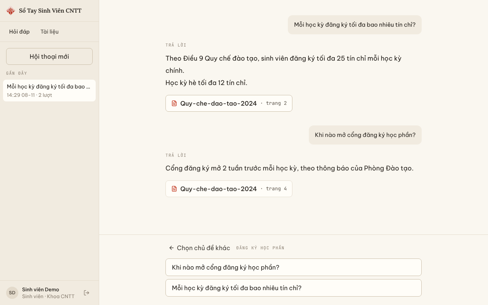
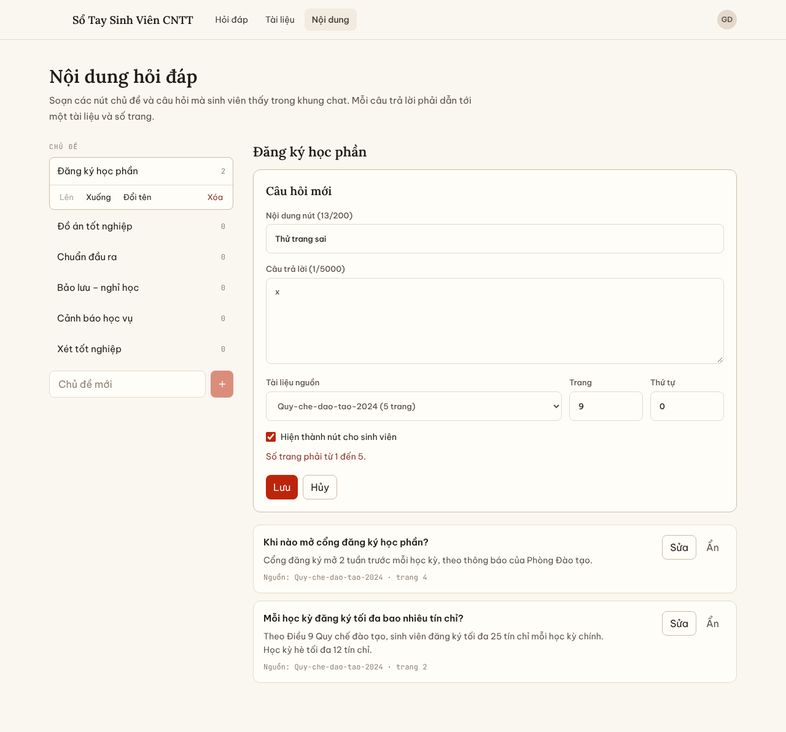
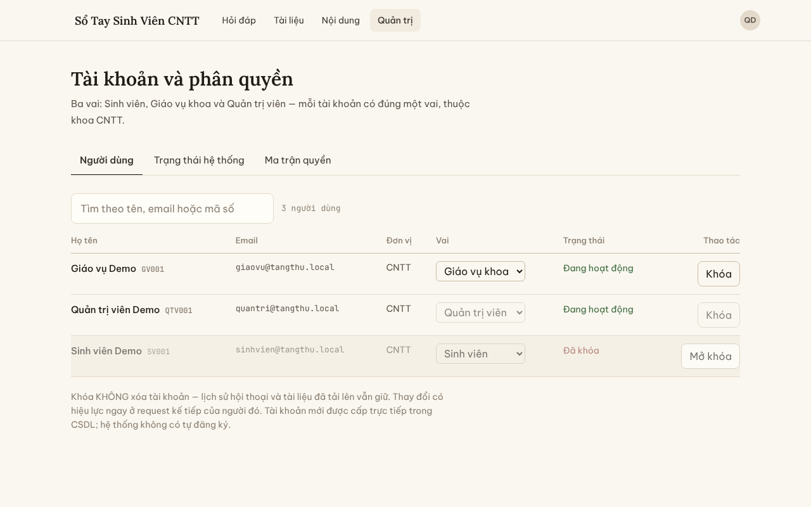

# Sổ Tay Sinh Viên CNTT

Hệ thống tra cứu quy định học vụ cho sinh viên **ngành Công nghệ Thông tin — Trường Đại học Kiến trúc
Đà Nẵng**. Đồ án học phần **Lập trình mạng máy tính**, xây dựng theo mô hình **client–server**.

Sinh viên dùng một **chatbot dạng nút chọn**: chọn chủ đề → chọn câu hỏi → nhận câu trả lời do giáo vụ
khoa soạn sẵn, kèm **tài liệu nguồn và số trang** để tự kiểm chứng. Hệ thống không dùng AI và không nhận
câu hỏi gõ tự do — câu trả lời luôn đúng nội dung giáo vụ đã duyệt.



## Chức năng

| Vai | Làm được gì |
|---|---|
| **Sinh viên** (`USER`) | Chọn chủ đề và câu hỏi, nhận câu trả lời kèm nguồn; mở tệp gốc đúng trang; xem lại hội thoại; tra cứu kho tài liệu |
| **Giáo vụ khoa** (`CONTENT_ADMIN`) | Mọi quyền của sinh viên + tải lên / đổi tên / gỡ tài liệu; tạo chủ đề; soạn câu hỏi – câu trả lời và gắn nguồn |
| **Quản trị viên** (`SYSTEM_ADMIN`) | Mọi quyền của giáo vụ + tra cứu, khóa / mở, phân quyền tài khoản; kiểm tra trạng thái hệ thống |

Quy tắc chính: mỗi request đọc lại vai từ CSDL nên khóa tài khoản hay đổi vai có hiệu lực ngay; quản trị
viên không tự khóa hay tự hạ vai; mỗi câu trả lời bắt buộc có tài liệu nguồn.

| Soạn nội dung (giáo vụ) | Quản trị tài khoản |
|---|---|
|  |  |

## Kiến trúc

```
 Trình duyệt ──HTTP──▶  web (Next.js, :3000)  ──/api/* ──▶  server-java (Spring Boot, :8080)  ──JDBC──▶  PostgreSQL 16
 (máy bất kỳ trong LAN)    giao diện                         REST API JSON, JWT                         6 bảng
                                                             + thư mục lưu tệp PDF / DOCX
```

- **Client:** trình duyệt gọi `/api/...` trên chính máy web; Next.js chuyển tiếp sang server, nên máy nào
  trong LAN mở `http://<IP máy chủ>:3000` cũng dùng được, không vướng CORS.
- **Server:** REST API, mỗi thao tác là một cặp request / response JSON. Xác thực bằng JWT (header
  `Authorization: Bearer`), mật khẩu băm BCrypt.
- **CSDL:** 6 bảng — `users`, `topics`, `questions`, `documents`, `conversations`, `messages` — quản lý
  bằng Flyway.

| Thành phần | Công nghệ |
|---|---|
| Server | Java 21, Spring Boot 3.3 (Web, Data JPA, Security, Validation), Flyway, jjwt, PDFBox |
| Web | Next.js 16, React 19, TypeScript, Tailwind CSS 4 |
| CSDL | PostgreSQL 16 |
| Triển khai | Docker Compose (db + api + web) |

## Chạy nhanh bằng Docker

Cần Docker và Docker Compose.

```bash
git clone https://github.com/hominhduc-dev/knowledge-base-rag.git
cd knowledge-base-rag
cp .env.example .env          # sửa DB_PASSWORD và JWT_SECRET (≥ 32 ký tự)
docker compose up --build
```

Mở **http://localhost:3000**. API ở `http://localhost:8080/api`.

### Tài khoản demo

Mật khẩu chung: `Matkhau@123`

| Đăng nhập | Vai |
|---|---|
| `SV001` | Sinh viên |
| `GV001` | Giáo vụ khoa |
| `QTV001` | Quản trị viên |

Dữ liệu demo có sẵn 6 chủ đề nhưng chưa có câu hỏi. Đăng nhập `GV001` → **Tài liệu** tải một tệp PDF lên →
**Nội dung** soạn câu hỏi và gắn trang nguồn → đăng nhập `SV001` để hỏi.

> Khi triển khai thật: đặt `FLYWAY_LOCATIONS=classpath:db/migration` trong `.env` để **không** tạo tài khoản
> demo, và đổi `JWT_SECRET`, `DB_PASSWORD`.

## Chạy khi phát triển (không dùng Docker)

Cần Java 21, Maven 3.9, Node.js 22, PostgreSQL 16.

```bash
# 1. CSDL
createuser -P tangthu                 # mật khẩu: tangthu
createdb -O tangthu tangthu

# 2. Server — http://localhost:8080
cd server-java
export JWT_SECRET="chuoi-ngau-nhien-dai-it-nhat-32-ky-tu"
mvn spring-boot:run

# 3. Web — http://localhost:3000 (terminal khác)
cd web
npm install
npm run dev
```

Chi tiết biến môi trường: [`server-java/README.md`](server-java/README.md), [`web/README.md`](web/README.md).

## Kiểm thử

```bash
# Server: 15 kiểm thử tích hợp trên PostgreSQL thật (cần database tangthu_test)
createdb -O tangthu tangthu_test
cd server-java && mvn test

# Web: kiểm tra kiểu, lint, build production
cd web && npm run typecheck && npm run lint && npm run build
```

Các kịch bản kiểm thử (đăng nhập, khóa tài khoản có hiệu lực ngay, đổi vai, tự sửa chính mình, chọn câu
hỏi, câu hỏi đã ẩn, hội thoại của người khác, tải trùng tệp, gỡ tài liệu đang dùng…) liệt kê ở
`docs/DAC-TA-TRIEN-KHAI.md` mục 9.

## Cấu trúc thư mục

```
.
├── server-java/                 Server Spring Boot
│   └── src/main/java/vn/tangthu/
│       ├── common/              JWT, phân quyền, xử lý lỗi, lưu tệp
│       ├── account/             M1 · Tài khoản      UC01–UC04
│       ├── chat/                M2 · Hỏi đáp        UC05, UC06
│       ├── content/             M3 · Nội dung       UC07, UC08, UC10–UC12, UC22, UC23
│       └── admin/               M4 · Quản trị       UC14–UC16, UC20
├── web/                         Web client Next.js
│   └── src/features/            auth, chat, documents, content, admin
├── docs/                        SRS, đặc tả triển khai, slide, ảnh chụp
├── docker-compose.yml           db + api + web
└── .env.example
```

## Tài liệu

| Tệp | Nội dung |
|---|---|
| [`docs/SRS.md`](docs/SRS.md) | Đặc tả yêu cầu phần mềm: phạm vi, tác nhân, 17 use case, yêu cầu dữ liệu, giao diện, phi chức năng, quy tắc nghiệp vụ, ma trận truy vết |
| [`docs/DAC-TA-TRIEN-KHAI.md`](docs/DAC-TA-TRIEN-KHAI.md) | Đặc tả triển khai: lược đồ CSDL, API REST, luồng xử lý, hướng dẫn Spring Boot, kịch bản kiểm thử |
| [`docs/slides/SRS-tac-nhan-va-use-case.pptx`](docs/slides/SRS-tac-nhan-va-use-case.pptx) | Slide SRS: tác nhân, use case, ma trận quyền, input / output, luồng |

## Ghi chú

Phiên bản trước của dự án (Node.js / Express, hỏi đáp tự do bằng RAG với Gemini) đã được thay thế; mã cũ
vẫn xem lại được trong lịch sử git.
