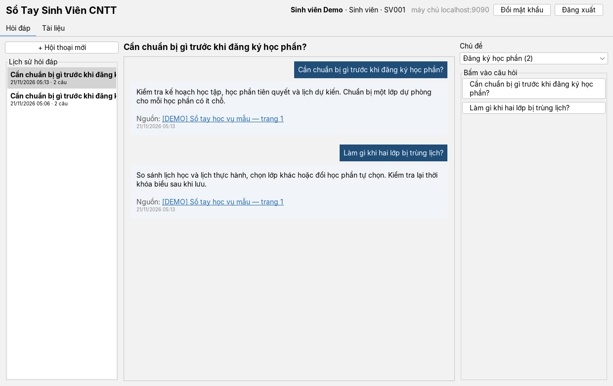
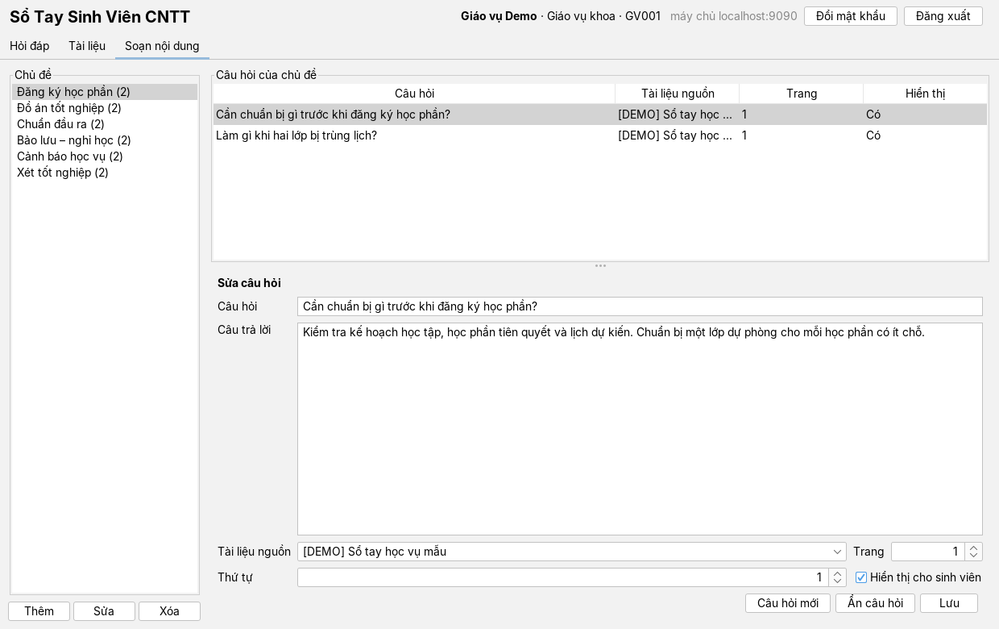
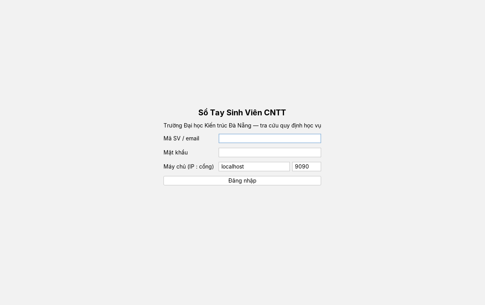
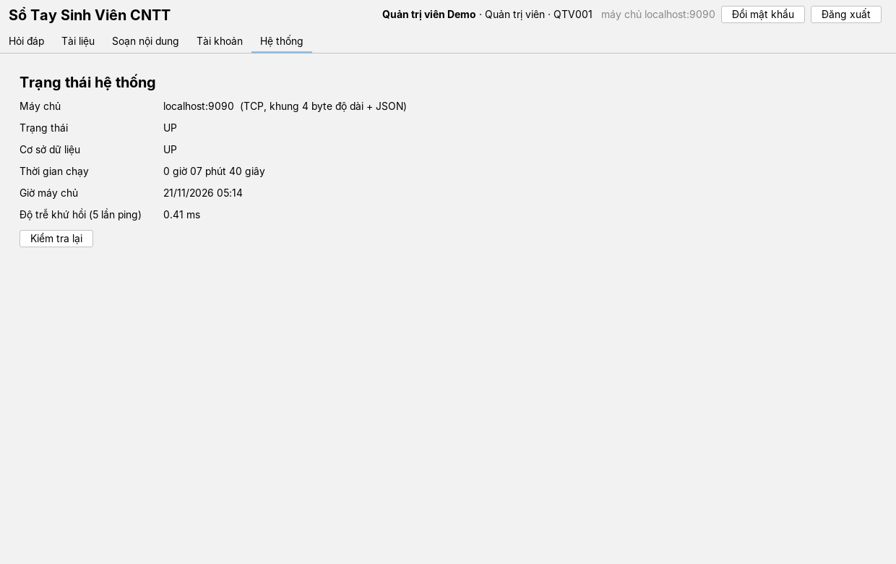

# Sổ Tay Sinh Viên CNTT

Hệ thống tra cứu quy định học vụ cho sinh viên **ngành Công nghệ Thông tin — Trường Đại học Kiến trúc
Đà Nẵng**. Đồ án học phần **Lập trình mạng máy tính**, xây dựng theo mô hình **client–server tách biệt,
giao tiếp qua TCP/IP bằng socket**: client là ứng dụng desktop Java Swing, server là máy chủ Java
`ServerSocket`.

Sinh viên dùng một **chatbot dạng nút chọn**: chọn chủ đề → chọn câu hỏi → nhận câu trả lời do giáo vụ
khoa soạn sẵn, kèm **tài liệu nguồn và số trang** để tự kiểm chứng. Hệ thống không dùng AI và không nhận
câu hỏi gõ tự do — câu trả lời luôn đúng nội dung giáo vụ đã duyệt.



## Chức năng

| Vai | Làm được gì |
|---|---|
| **Sinh viên** (`USER`) | Chọn chủ đề và câu hỏi, nhận câu trả lời kèm nguồn; mở tệp gốc đúng trang; xem lại hội thoại; tra cứu kho tài liệu |
| **Giáo vụ khoa** (`CONTENT_ADMIN`) | Mọi quyền của sinh viên + tải lên / đổi tên / gỡ tài liệu; tạo chủ đề; soạn câu hỏi – câu trả lời và gắn nguồn |
| **Quản trị viên** (`SYSTEM_ADMIN`) | Mọi quyền của giáo vụ + tra cứu, khóa / mở, phân quyền tài khoản; kiểm tra trạng thái hệ thống |

Quy tắc chính: mỗi yêu cầu đọc lại vai từ CSDL nên khóa tài khoản hay đổi vai có hiệu lực ngay; quản trị
viên không tự khóa hay tự hạ vai; mỗi câu trả lời bắt buộc có tài liệu nguồn.

| Soạn nội dung (giáo vụ) | Quản trị tài khoản |
|---|---|
|  |  |
| **Đăng nhập (nhập IP máy chủ)** | **Trạng thái hệ thống, độ trễ TCP** |
|  |  |

## Kiến trúc

```
 client/ (Java Swing)            TCP/IP, cổng 9090              server/ (Java)                 PostgreSQL 16
 ┌──────────────────┐   java.net.Socket ──▶ ServerSocket   ┌──────────────────────┐  JDBC   ┌──────────┐
 │ máy sinh viên    │ ── [4 byte độ dài][JSON yêu cầu] ──▶ │ luồng nhận kết nối   │ ──────▶ │ 6 bảng   │
 │ máy giáo vụ      │ ◀─ [4 byte độ dài][JSON phản hồi] ── │ + mỗi client 1 luồng │         └──────────┘
 │ … (mọi máy LAN)  │       một kết nối giữ suốt phiên     │ + thư mục lưu tệp    │
 └──────────────────┘                                      └──────────────────────┘
```

- **Giao thức:** mỗi thông điệp là một *khung* — 4 byte độ dài (big-endian) rồi JSON UTF-8.
  Yêu cầu `{ "id", "action", "token", "data" }` → phản hồi `{ "id", "ok", "data" | "error" }`.
  25 action, ví dụ `auth.login`, `chat.ask`, `document.upload`. Đặc tả đầy đủ:
  [`docs/DAC-TA-TRIEN-KHAI.md` mục 6](docs/DAC-TA-TRIEN-KHAI.md#6-giao-thức-tcp-socket).
- **Server:** không dùng HTTP. `SocketServer` mở `ServerSocket`, mỗi client được một luồng trong pool;
  `SocketDispatcher` kiểm token JWT, đọc lại người dùng từ CSDL, kiểm vai rồi chuyển action tới controller
  của module.
- **Client:** `SocketClient` giữ một `Socket` lâu dài, tự nối lại khi mất kết nối; mọi lời gọi mạng chạy
  bằng `SwingWorker` nên giao diện không bị treo. Tệp tải lên / mở nguồn đi trong JSON dạng base64.
- **CSDL:** 6 bảng — `users`, `topics`, `questions`, `documents`, `conversations`, `messages` — quản lý
  bằng Flyway.

| Thành phần | Công nghệ |
|---|---|
| Server | Java 21, Spring Boot 3.3 (không web: Data JPA, Validation), `java.net.ServerSocket`, Flyway, jjwt, BCrypt, PDFBox |
| Client | Java 21 Swing, FlatLaf, Jackson, `java.net.Socket` |
| CSDL | PostgreSQL 16 |
| Triển khai | Docker Compose (db + server); client là một tệp `.jar` chạy trên từng máy |

## Chạy nhanh

Cần Docker (cho server + CSDL) và Java 21 + Maven (cho client).

```bash
git clone https://github.com/hominhduc-dev/So-Tay-Sinh-Vien-CNTT-DAU.git
cd So-Tay-Sinh-Vien-CNTT-DAU
cp .env.example .env          # sửa DB_PASSWORD và JWT_SECRET (≥ 32 ký tự)
docker compose up --build     # server TCP socket ở cổng 9090

# terminal khác — client desktop
cd client && mvn package
java -jar target/tangthu-client.jar                  # nối localhost:9090
java -jar target/tangthu-client.jar 192.168.1.10 9090   # nối máy chủ khác trong LAN
```

### Tài khoản demo

Mật khẩu chung: `Matkhau@123`

| Đăng nhập | Vai |
|---|---|
| `SV001` | Sinh viên |
| `GV001` | Giáo vụ khoa |
| `QTV001` | Quản trị viên |

Dữ liệu demo tự khởi tạo khi chạy server với cấu hình mặc định. Đăng nhập `SV001` → tab **Hỏi đáp**
để thử 12 câu hỏi mẫu thuộc 6 chủ đề. Mỗi câu trả lời dẫn đến một trang trong PDF **[DEMO] Sổ tay học vụ mẫu**.

> Khi triển khai thật: đặt `FLYWAY_LOCATIONS=classpath:db/migration` trong `.env` để **không** tạo tài khoản
> demo, và đổi `JWT_SECRET`, `DB_PASSWORD`.

## Chạy khi phát triển (không dùng Docker)

Cần Java 21, Maven 3.9, PostgreSQL 16.

```bash
# 1. CSDL
createuser -P tangthu                 # mật khẩu: tangthu
createdb -O tangthu tangthu

# 2. Server — TCP socket cổng 9090
cd server
export JWT_SECRET="chuoi-ngau-nhien-dai-it-nhat-32-ky-tu"
mvn spring-boot:run

# 3. Client (terminal khác)
cd client
mvn package && java -jar target/tangthu-client.jar
```

Chi tiết biến môi trường: [`server/README.md`](server/README.md), [`client/README.md`](client/README.md).

## Kiểm thử

```bash
# Server: 19 kiểm thử tích hợp qua socket thật, trên PostgreSQL thật (cần database tangthu_test)
createdb -O tangthu tangthu_test
cd server && mvn test

# Client: SocketClient với server giả
cd client && mvn test
```

Các kịch bản (nhiều yêu cầu trên một kết nối, khung hỏng, khung quá lớn, 10 client đồng thời, đăng nhập,
khóa tài khoản có hiệu lực ngay, đổi vai, tự sửa chính mình, câu hỏi đã ẩn, hội thoại của người khác, tải
trùng tệp, gỡ tài liệu đang dùng…) liệt kê ở `docs/DAC-TA-TRIEN-KHAI.md` mục 9. Quan sát gói tin bằng
Wireshark với bộ lọc `tcp.port == 9090`.

## Cấu trúc thư mục — mô hình MVC, chia theo module

```
.
├── server/                               Server Java — Model + Controller
│   └── src/main/java/vn/tangthu/
│       ├── common/                       dùng chung
│       │   ├── socket/                   ServerSocket, đọc/ghi khung, điều phối action — tầng mạng
│       │   └── config/ security/ exception/ dto/ util/
│       ├── account/                      M1 · Tài khoản
│       ├── chat/                         M2 · Hỏi đáp
│       ├── content/                      M3 · Nội dung
│       └── admin/                        M4 · Quản trị
│           (mỗi module: model/ repository/ service/ controller/ dto/)
├── client/                               Client Java Swing — View (+ Model, Controller phía client)
│   └── src/main/java/vn/tangthu/client/
│       ├── App.java                      điểm khởi động
│       ├── common/
│       │   ├── net/                      SocketClient, FrameCodec — tầng mạng
│       │   └── view/                     MainFrame (tab theo vai), Async, FileOpener
│       ├── account/                      M1 · LoginPanel, ProfileDialog, ChangePasswordDialog
│       ├── chat/                         M2 · ChatPanel
│       ├── content/                      M3 · DocumentsPanel, ContentPanel
│       └── admin/                        M4 · UsersPanel, HealthPanel
│           (mỗi module: model/ controller/ view/)
├── docs/                                 SRS, đặc tả triển khai + giao thức, báo cáo, sơ đồ, slide, ảnh
├── docker-compose.yml                    db + server
└── .env.example
```

| Tầng | Ở đâu | Vai trò |
|---|---|---|
| **Model** | `server/.../<module>/model/`, `repository/`; `client/.../<module>/model/` | Entity JPA ánh xạ bảng PostgreSQL; record dữ liệu phía client |
| **Controller** | `server/.../<module>/controller/` (+ `service/`); `client/.../<module>/controller/` | Server: nhận action, kiểm quyền, xử lý nghiệp vụ. Client: gửi action qua socket |
| **View** | `client/.../<module>/view/` | Màn hình Swing |

## Phân công module

Mỗi thành viên phụ trách trọn **một module ở cả server và client**.

| Module | Use case | Server | Client | Người phụ trách |
|---|---|---|---|---|
| M1 · Tài khoản | UC01–UC04 | `server/src/main/java/vn/tangthu/account/` | `client/src/main/java/vn/tangthu/client/account/` | _Họ tên — @github_ |
| M2 · Hỏi đáp | UC05, UC06, UC08 | `server/src/main/java/vn/tangthu/chat/` | `client/src/main/java/vn/tangthu/client/chat/` | _Họ tên — @github_ |
| M3 · Nội dung | UC07, UC10–UC12, UC22, UC23 | `server/src/main/java/vn/tangthu/content/` | `client/src/main/java/vn/tangthu/client/content/` | _Họ tên — @github_ |
| M4 · Quản trị | UC14–UC16, UC20 | `server/src/main/java/vn/tangthu/admin/` | `client/src/main/java/vn/tangthu/client/admin/` | _Họ tên — @github_ |
| Dùng chung (tầng mạng) | — | `server/.../common/` (socket/), `db/` | `client/.../common/` (net/, view/), `App.java` | _Nhóm trưởng_ |

## Tài liệu

| Tệp | Nội dung |
|---|---|
| [`docs/reports/bao-cao-so-tay-sinh-vien-cntt.docx`](docs/reports/bao-cao-so-tay-sinh-vien-cntt.docx) | Báo cáo phân tích và thiết kế hệ thống |
| [`docs/diagrams/so-do-he-thong.drawio`](docs/diagrams/so-do-he-thong.drawio) | 31 trang sơ đồ: use case, BFD, ngữ cảnh, **kiến trúc TCP socket**, **cấu trúc MVC client – server**, ERD, **vòng đời kết nối TCP**, tuần tự UC01–UC23 (theo action socket), sơ đồ lớp |
| [`docs/SRS.md`](docs/SRS.md) | Đặc tả yêu cầu phần mềm: phạm vi, tác nhân, 17 use case, yêu cầu dữ liệu, giao diện, phi chức năng, quy tắc nghiệp vụ, ma trận truy vết |
| [`docs/DAC-TA-TRIEN-KHAI.md`](docs/DAC-TA-TRIEN-KHAI.md) | Đặc tả triển khai: lược đồ CSDL, **giao thức TCP socket** (mục 6), luồng xử lý, hiện thực server / client, kịch bản kiểm thử |
| [`docs/slides/SRS-tac-nhan-va-use-case.pptx`](docs/slides/SRS-tac-nhan-va-use-case.pptx) | Slide SRS: tác nhân, use case, ma trận quyền, input / output, luồng |

## Ghi chú

Các phiên bản trước (Node.js / Express với RAG Gemini; rồi REST API + web Next.js) đã được thay bằng kiến
trúc socket hiện tại; mã cũ vẫn xem lại được trong lịch sử git.
