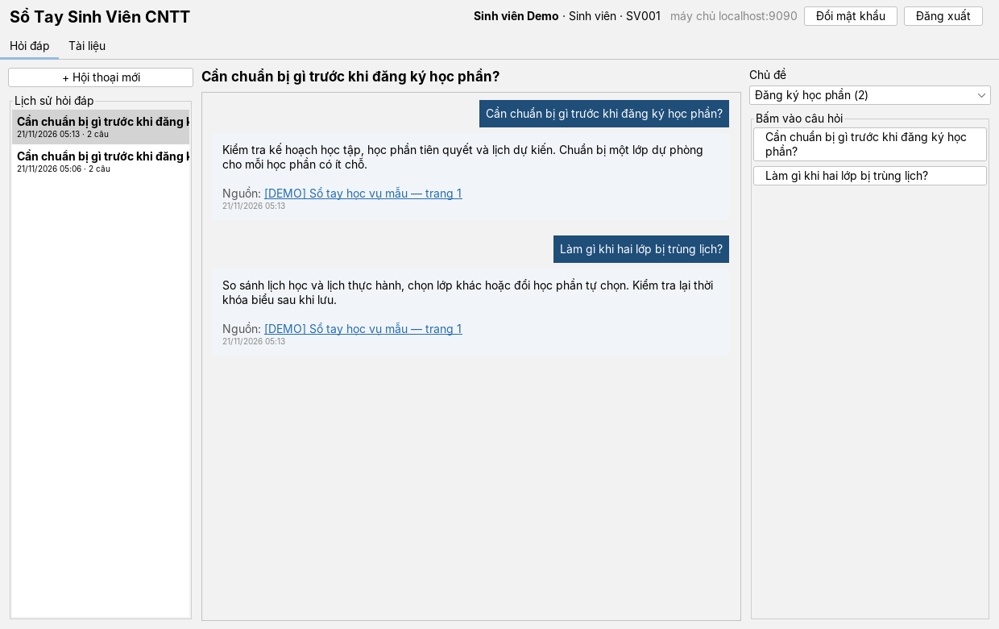

# Client — Sổ Tay Sinh Viên CNTT

Ứng dụng **desktop Java Swing**. Kết nối tới server bằng **TCP socket** (`java.net.Socket`), giữ một kết
nối suốt phiên đăng nhập; mỗi thao tác gửi một khung `[4 byte độ dài][JSON]` và nhận một khung phản hồi.



## Chạy

Cần Java 21 (chạy) và Maven 3.9 (build).

```bash
cd client
mvn package                                   # → target/tangthu-client.jar (đã gồm thư viện)
java -jar target/tangthu-client.jar           # máy chủ localhost:9090
java -jar target/tangthu-client.jar 192.168.1.10 9090   # máy chủ khác trong LAN
```

Cũng đổi được IP / cổng ngay ở màn đăng nhập, hoặc đặt biến môi trường `TANGTHU_HOST`, `TANGTHU_PORT`.

## Cấu trúc — module trước, tầng MVC sau

```
src/main/java/vn/tangthu/client/
├── App.java                     main: đọc IP / cổng, bật giao diện FlatLaf
├── common/
│   ├── net/                     tầng mạng TCP
│   │   ├── SocketClient         mở Socket, gửi { id, action, token, data }, chờ phản hồi cùng id,
│   │   │                        tự nối lại khi mất kết nối; synchronized — nhiều luồng dùng chung an toàn
│   │   ├── FrameCodec           đóng / tách khung (giống hệt phía server)
│   │   ├── ApiError             lỗi server trả về hoặc NETWORK_ERROR
│   │   └── PageResult           một trang kết quả
│   └── view/                    MainFrame (đăng nhập ↔ tab theo vai), Async (gọi mạng bằng SwingWorker,
│                                không treo giao diện), FileOpener (mở tệp nguồn), Ui
├── account/   M1 · Tài khoản    model/ controller/ view/   LoginPanel, ProfileDialog, ChangePasswordDialog
├── chat/      M2 · Hỏi đáp      model/ controller/ view/   ChatPanel
├── content/   M3 · Nội dung     model/ controller/ view/   DocumentsPanel, ContentPanel
└── admin/     M4 · Quản trị     model/ controller/ view/   UsersPanel, HealthPanel
```

| Tầng | Thư mục | Vai trò |
|---|---|---|
| **Model** | `<module>/model/` | `record` Java nhận từ JSON (Jackson) |
| **Controller** | `<module>/controller/` | Mỗi phương thức gửi một action qua `SocketClient` — ví dụ `ChatController.ask` → `chat.ask` |
| **View** | `<module>/view/` | Màn hình Swing; gọi controller qua `Async.run(...)` |

## Tab theo vai

| Tab | Sinh viên | Giáo vụ | Quản trị viên |
|---|:-:|:-:|:-:|
| Hỏi đáp — chọn chủ đề, bấm câu hỏi, mở nguồn, xem lại hội thoại | ✓ | ✓ | ✓ |
| Tài liệu — tìm, mở; giáo vụ thêm tải lên / đổi tên / gỡ | ✓ | ✓ | ✓ |
| Soạn nội dung — chủ đề, câu hỏi – câu trả lời gắn nguồn | | ✓ | ✓ |
| Tài khoản — tìm, khóa / mở, đổi vai | | | ✓ |
| Hệ thống — trạng thái server, CSDL, độ trễ ping TCP | | | ✓ |

Ẩn tab chỉ để gọn giao diện; quyền thật luôn được server kiểm ở mỗi yêu cầu.

## Kiểm thử

```bash
mvn test    # SocketClientTest: server giả trên cổng ngẫu nhiên — gửi / nhận khung, tiếng Việt, lỗi, mất mạng
```
